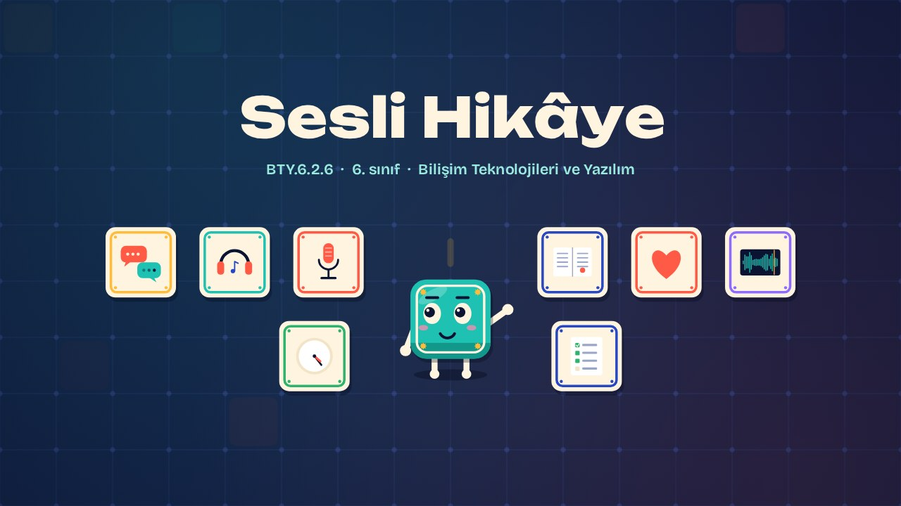
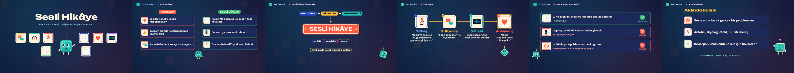

# Sesli Hikâye · A Story in Sound

**▶ Tarayıcıda izleyin / Watch in the browser:** https://hakanatas.github.io/sesli-hikaye/ 
**⬇ MP4 + altyazılar / MP4 + subtitles:** [Releases](https://github.com/hakanatas/sesli-hikaye/releases) 
**✎ Kullanılan istem / The prompt behind it:** [PROMPT.md](PROMPT.md) 
**🎞 Bütün filmler / All films:** [Bilişim Filmleri](https://hakanatas.github.io/bilisim-filmleri/?sinif=6)

> **TR —** 6. sınıf Bilişim Teknolojileri ve Yazılım dersinin "Dijital Ürün Tasarımı ve Geliştirme" temasındaki BTY.6.2.6 öğrenme çıktısı için hazırlanmış, tamamen JavaScript ile çizilen 1,9 dakikalık animasyon; ses efektleri ve hafif fon müziği de kodla üretilir. Sesli bir ürünle çözülebilecek gerçek hayat problemleri seçilir: yaşlıların yalnızlığı, deprem hazırlığı, sahte haberler. Sesli hikâyenin unsurları (anlatıcı, diyalog, ses efekti, müzik, sessizlik ve mesaj) belirlenir; izinli müzik kullanmanın önemi hatırlatılır. "Dedemle geçmişe yolculuk" adlı bir sesli hikâyenin senaryosu dört bölüm hâlinde yazılır. Son olarak senaryo bütünlük ve kullanışlılık açısından değerlendirilir. Altyazılar Türkçe, İngilizce ya da ikisi birlikte seçilebilir.

A 1.9-minute animation, with code-generated sound, for **6th-grade IT and Software** (Türkiye Yüzyılı Maarif Modeli). Real-life problems suited to audio are chosen; audio story elements (narrator, dialogue, sound effects, music, silence, message) are set with a note on licensed music; a four-part script, "A trip to the past with Grandpa", is written; and it is checked for coherence and usefulness. The guide is **Karo**, a living glazed tile who never speaks: he tells the story with his face, his arms and the blinking cursor above his head.

## Öğrenme çıktısı · Learning outcome

MEB, Türkiye Yüzyılı Maarif Modeli, Bilişim Teknolojileri ve Yazılım Dersi Öğretim Programı, 6. sınıf, 2. tema "Dijital Ürün Tasarımı ve Geliştirme":

**BTY.6.2.6. Ses dosyası için kurgu oluşturabilme**
- a) Ses dosyası hazırlanacak gerçek hayat problemini belirler.
- b) Ses dosyası hazırlama sürecinde kullanılacak hikâye/senaryo unsurlarını belirler.
- c) Belirlenen unsurları kapsayan hikâye/senaryo oluşturur.
- ç) Hikâyeyi/senaryoyu bütünlük/kullanışlılık açısından değerlendirir.

## Sahneler · Scenes

| # | Zaman | Sahne | Ne oluyor | Çıktı |
|---|---|---|---|---|
| 1 | 0:00–0:16 | Giriş |  |  |
| 2 | 0:16–0:33 | Problemi seç | Sesli bir ürünle anlatılacak gerçek hayat problemleri. | a |
| 3 | 0:33–1:03 | Sesli hikâyenin unsurları | Anlatıcı, diyalog, ses efekti, müzik, sessizlik ve mesaj. | b |
| 4 | 1:03–1:20 | Senaryo | Unsurları kapsayan dört bölümlük sesli hikâye senaryosu. | c |
| 5 | 1:20–1:42 | Senaryoyu değerlendir | Senaryo bütünlük ve kullanışlılık açısından değerlendirilir. | ç |
| 6 | 1:42–1:57 | Aklında kalsın |  |  |

## Çalıştırma · Running it

- **Önizleme:** `index.html` dosyasına çift tıklayın (çevrim dışı da çalışır). Klavye: boşluk oynat/duraklat, ← → 3 sn, Home başa. Adrese `?altyazi=en`, `?bicim=vertical` ya da `?ses=0` eklenebilir.
- **MP4:** bir kez `npm install`, sonra `npm run export -- --format=both --captions=tr` (720p yatay ve dikey, sesli). Google Chrome yüklüyse Playwright onu kullanır (`channel: 'chrome'`); ffmpeg gerekir.
- **Altyazı ve seslendirme notları:** `npm run srt` → `out/sesli-hikaye_tr.srt`, `_en.srt`, `_tr-en.srt`, `_seslendirme-notlari.txt`.
- **Sürüm dosyaları:** `npm run release` → `release/` klasöründe v1.0'ın 6 dosyası.
- **Yazı kontrolü:** `npm run check` yatay ve dikey düzende, üç altyazı seçeneğiyle üst üste binen, kenardan taşan ya da 720p'de 17 pikselden küçük kalan yazı arar.
- **Düzenleme:** senaryo (sahneler, altyazılar, seslendirme notları) `scenes/film.js` içindedir; değiştirince `npm run build` süreleri, `captions.js` ve `film.config.js` dosyalarını yeniden üretir. Sahne şablonları `src/kit/`, Karo `src/draw/karo.js`, ses `src/audio/synth.js`.

Her kare `renderFrame(t)` ile zamanın saf fonksiyonu olarak çizilir; rastgelelik tohumludur, MP4 ekran kaydı değil kare kare üretimdir. Ses de dosyadan çalınmaz: aynı olay listesinden hesaplanır. Yazı tipleri: Unbounded ve Bricolage Grotesque (SIL OFL 1.1), dosyaya gömülü.

## Lisans · License

**TR —** Bu film ve kodu [Creative Commons Atıf-GayriTicari 4.0 Uluslararası (CC BY-NC 4.0)](https://creativecommons.org/licenses/by-nc/4.0/deed.tr) lisansıyla paylaşılır. Ticari olmayan her amaçla (derste, okulda, eğitim materyalinde) kopyalayabilir, paylaşabilir ve değiştirebilirsiniz; ancak **kaynak göstermek zorunludur**: eser sahibinin adı ve bu deponun bağlantısı belirtilmeden kullanılamaz. Ticari kullanım (satış, ücretli ürün ya da yayın) için izin alınmalıdır.

**EN —** This film and its code are licensed under [Creative Commons Attribution-NonCommercial 4.0 International (CC BY-NC 4.0)](https://creativecommons.org/licenses/by-nc/4.0/). You may copy, share and adapt them for non-commercial purposes, but **attribution is required**: they may not be used without crediting the author and linking to this repository. Commercial use requires permission.

Atıf örneği / Required credit: *“Sesli Hikâye”, Hakan Ataş, Bilişim Filmleri — https://github.com/hakanatas/sesli-hikaye — CC BY-NC 4.0*
